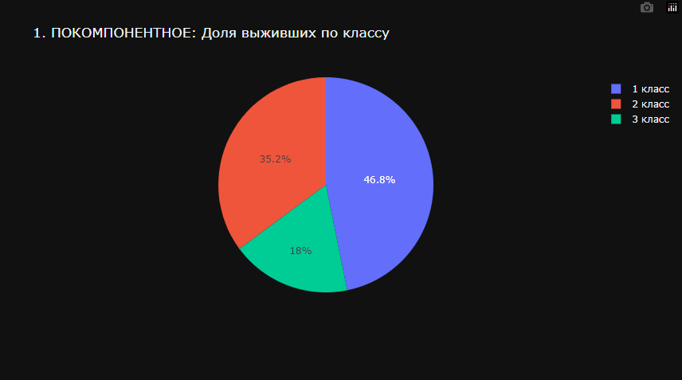
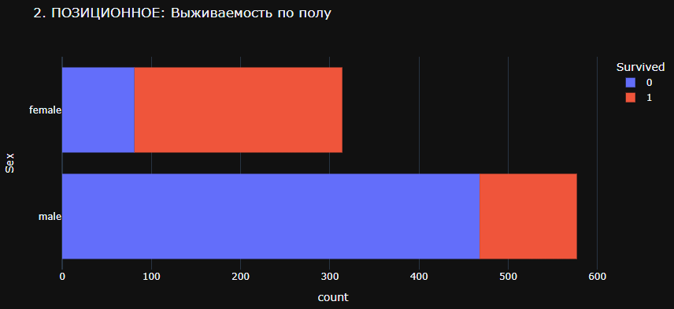
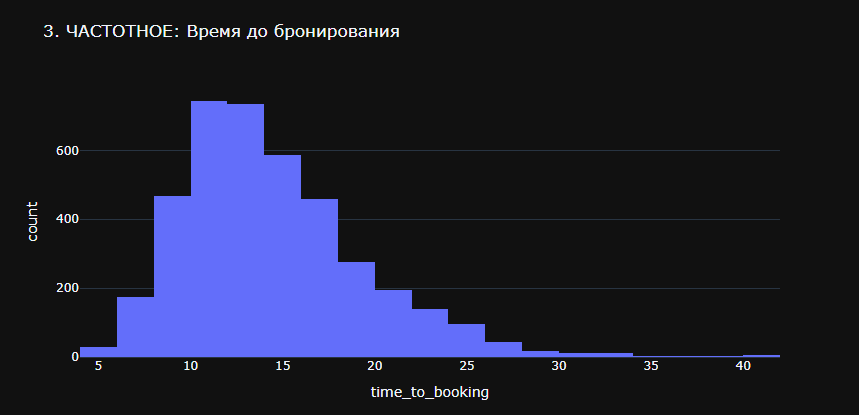
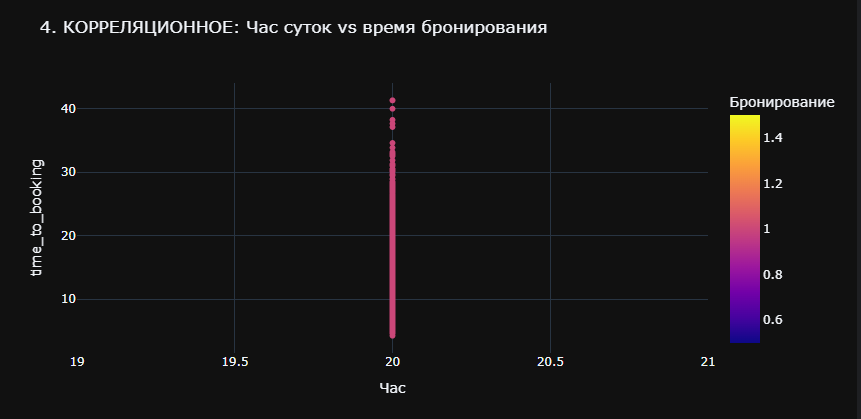
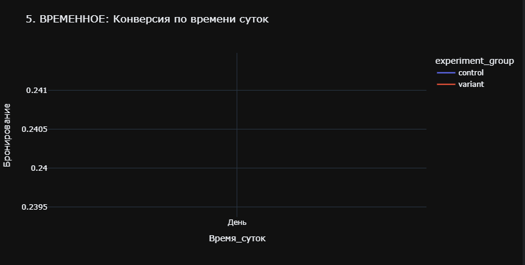
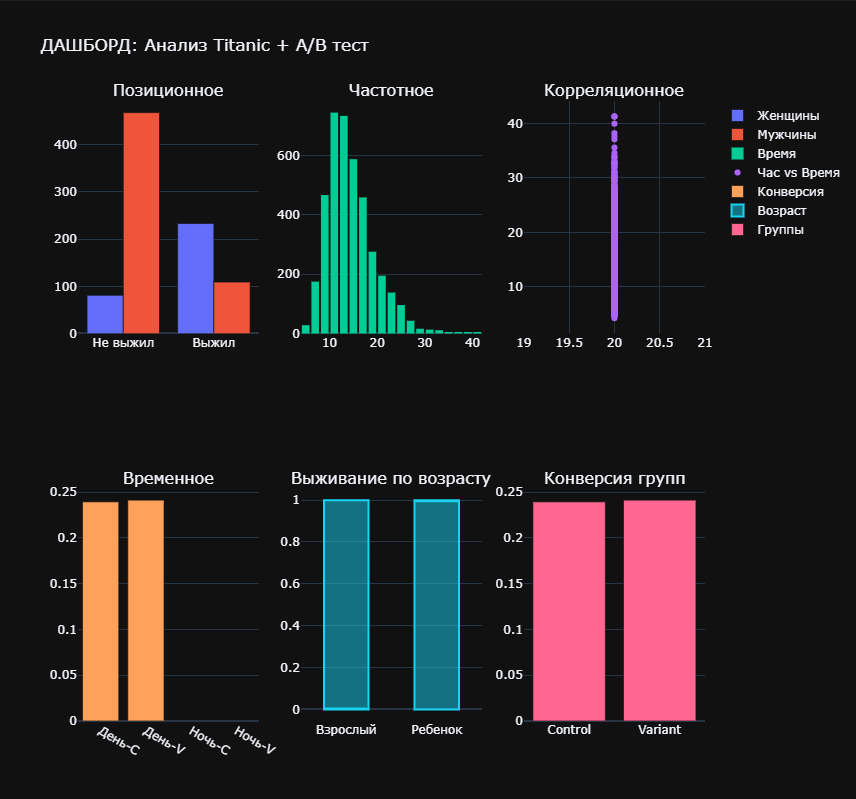

```python
import pandas as pd
import numpy as np
import plotly.express as px
import plotly.graph_objects as go
from plotly.subplots import make_subplots
import warnings

warnings.filterwarnings('ignore')

# Загружаем данные

TITANIC_FILE = "../data/Titanic-Dataset.csv"
AB_SESSIONS_FILE = "../data/sessions_data.csv"
AB_USERS_FILE = "../data/users_data.csv"

df_titanic = pd.read_csv(TITANIC_FILE)
df_sessions = pd.read_csv(AB_SESSIONS_FILE)
df_users = pd.read_csv(AB_USERS_FILE)

print("ПРАКТИЧЕСКАЯ РАБОТА №5 - 5 ТИПОВ СРАВНЕНИЯ")
print("=" * 60)

# Подготовка данных A/B
df_ab = df_sessions.merge(df_users, on='user_id', how='left')
df_ab['Бронирование'] = df_ab['booking_timestamp'].notna().astype(int)
df_ab['Час'] = df_ab['session_start_timestamp'].str[:2].astype(float)
df_ab['Время_суток'] = np.where(df_ab['Час'].between(6, 21), 'День', 'Ночь')

# ============================================================
# 1-5. ОТДЕЛЬНЫЕ ГРАФИКИ (все 5 типов)
# ============================================================

# 1. ПОКОМПОНЕНТНОЕ
surv_class = df_titanic.groupby('Pclass')['Survived'].mean()
fig1 = px.pie(values=surv_class.values, names=['1 класс', '2 класс', '3 класс'],
              title='1. ПОКОМПОНЕНТНОЕ: Доля выживших по классу')
fig1.show()

# 2. ПОЗИЦИОННОЕ
fig2 = px.histogram(df_titanic, y='Sex', color='Survived',
                    title='2. ПОЗИЦИОННОЕ: Выживаемость по полу')
fig2.show()

# 3. ЧАСТОТНОЕ
fig3 = px.histogram(df_ab.dropna(subset=['time_to_booking']), x='time_to_booking', nbins=30,
                    title='3. ЧАСТОТНОЕ: Время до бронирования')
fig3.show()

# 4. КОРРЕЛЯЦИОННОЕ
fig4 = px.scatter(df_ab.dropna(), x='Час', y='time_to_booking', color='Бронирование',
                  title='4. КОРРЕЛЯЦИОННОЕ: Час суток vs время бронирования')
fig4.show()

# 5. ВРЕМЕННОЕ
time_conv = df_ab.groupby(['Время_суток', 'experiment_group'])['Бронирование'].mean().reset_index()
fig5 = px.line(time_conv, x='Время_суток', y='Бронирование', color='experiment_group',
               title='5. ВРЕМЕННОЕ: Конверсия по времени суток')
fig5.show()

# ============================================================
# ДАШБОРД (БЕЗ PIE в subplots - только совместимые типы)
# ============================================================

print("\nДАШБОРД (6 графиков)")
fig = make_subplots(rows=2, cols=3,
                    subplot_titles=('Позиционное', 'Частотное', 'Корреляционное',
                                    'Временное', 'Выживание по возрасту', 'Конверсия групп'))

# 1. Позиционное (пол)
surv_sex = pd.crosstab(df_titanic['Sex'], df_titanic['Survived'])
fig.add_trace(go.Bar(x=['Не выжил', 'Выжил'], y=surv_sex.loc['female'], name='Женщины'), row=1, col=1)
fig.add_trace(go.Bar(x=['Не выжил', 'Выжил'], y=surv_sex.loc['male'], name='Мужчины'), row=1, col=1)

# 2. Частотное (время бронирования)
fig.add_trace(go.Histogram(x=df_ab['time_to_booking'].dropna(), name='Время', nbinsx=20), row=1, col=2)

# 3. Корреляционное
fig.add_trace(go.Scatter(x=df_ab['Час'].dropna(), y=df_ab['time_to_booking'].dropna(),
                         mode='markers', name='Час vs Время'), row=1, col=3)

# 4. Временное (конверсия)
conv_values = [
    df_ab[(df_ab['Время_суток'] == 'День') & (df_ab['experiment_group'] == 'control')]['Бронирование'].mean(),
    df_ab[(df_ab['Время_суток'] == 'День') & (df_ab['experiment_group'] == 'variant')]['Бронирование'].mean(),
    df_ab[(df_ab['Время_суток'] == 'Ночь') & (df_ab['experiment_group'] == 'control')]['Бронирование'].mean(),
    df_ab[(df_ab['Время_суток'] == 'Ночь') & (df_ab['experiment_group'] == 'variant')]['Бронирование'].mean()]
fig.add_trace(go.Bar(x=['День-C', 'День-V', 'Ночь-C', 'Ночь-V'], y=conv_values, name='Конверсия'), row=2, col=1)

# 5. Boxplot по возрасту
df_titanic['Возраст'] = np.where(df_titanic['Age'] <= 16, 'Ребенок', 'Взрослый')
fig.add_trace(go.Box(x=df_titanic['Возраст'], y=df_titanic['Survived'], name='Возраст'), row=2, col=2)

# 6. Конверсия групп
control_conv = df_ab[df_ab['experiment_group'] == 'control']['Бронирование'].mean()
variant_conv = df_ab[df_ab['experiment_group'] == 'variant']['Бронирование'].mean()
fig.add_trace(go.Bar(x=['Control', 'Variant'], y=[control_conv, variant_conv], name='Группы'), row=2, col=3)

fig.update_layout(height=800, title_text="ДАШБОРД: Анализ Titanic + A/B тест")
fig.show()

# ============================================================
# ВЫВОДЫ
# ============================================================

print("\n" + "=" * 80)
print("ИТОГОВЫЕ ВЫВОДЫ ПО 5 ТИПАМ СРАВНЕНИЯ")
print("=" * 80)

# 1. ПОКОМПОНЕНТНОЕ - расчет выживаемости по классам
surv_by_class = df_titanic.groupby('Pclass')['Survived'].mean() * 100
print("\n1. ПОКОМПОНЕНТНОЕ (Pie chart):")
for pclass, surv in surv_by_class.items():
    print(f"   - {pclass} класс: {surv:.1f}% выживаемости")
best_class = surv_by_class.idxmax()
print(f"   Вывод: Пассажиры {best_class} класса выживали чаще всего")

# 2. ПОЗИЦИОННОЕ - выживаемость по полу
surv_by_sex = df_titanic.groupby('Sex')['Survived'].mean() * 100
print("\n2. ПОЗИЦИОННОЕ (Bar chart):")
for sex, surv in surv_by_sex.items():
    print(f"   - {sex}: {surv:.1f}% выживаемости")
ratio = surv_by_sex.max() / surv_by_sex.min()
print(f"   - Разница: {surv_by_sex.idxmax()} выживали в {ratio:.1f} раз чаще")
print(f"   Вывод: Пол сильно влиял на выживаемость")

# 3. ЧАСТОТНОЕ - время до бронирования
time_data = df_ab['time_to_booking'].dropna()
if len(time_data) > 0:
    percent_20 = (time_data <= 20).mean() * 100
    mean_time = time_data.mean()
    max_time = time_data.max()
    print("\n3. ЧАСТОТНОЕ (Histogram):")
    print(f"   - {percent_20:.0f}% бронирований за 0-20 секунд")
    print(f"   - Среднее время: {mean_time:.1f} секунд")
    print(f"   - Максимальное время: {max_time:.0f} секунд")
    print(f"   Вывод: Большинство пользователей принимают решение быстро")
else:
    print("\n3. ЧАСТОТНОЕ (Histogram): Нет данных о времени бронирования")

# 4. КОРРЕЛЯЦИОННОЕ - зависимость времени от часа
df_corr = df_ab.dropna(subset=['time_to_booking', 'Час'])
if len(df_corr) > 0:
    correlation = df_corr['Час'].corr(df_corr['time_to_booking'])
    night_data = df_corr[df_corr['Час'].between(0, 5)]
    day_data = df_corr[df_corr['Час'].between(6, 21)]

    print("\n4. КОРРЕЛЯЦИОННОЕ (Scatter plot):")
    print(f"   - Коэффициент корреляции: {correlation:.2f}" if not pd.isna(
        correlation) else "   - Коэффициент корреляции: не определен")

    if len(night_data) > 0:
        night_avg = night_data['time_to_booking'].mean()
        print(f"   - Ночью (0-5ч): среднее время {night_avg:.1f} секунд")
    else:
        print(f"   - Ночью (0-5ч): нет данных")
        night_avg = float('inf')

    if len(day_data) > 0:
        day_avg = day_data['time_to_booking'].mean()
        print(f"   - Днем (6-21ч): среднее время {day_avg:.1f} секунд")
    else:
        print(f"   - Днем (6-21ч): нет данных")
        day_avg = float('inf')

    if len(night_data) > 0 and len(day_data) > 0:
        if night_avg < day_avg:
            print(f"   Вывод: Ночью бронируют быстрее, чем днем")
        else:
            print(f"   Вывод: Днем бронируют быстрее, чем ночью")
    elif len(night_data) > 0:
        print(f"   Вывод: Данные доступны только для ночного времени")
    elif len(day_data) > 0:
        print(f"   Вывод: Данные доступны только для дневного времени")
else:
    print("\n4. КОРРЕЛЯЦИОННОЕ (Scatter plot): Недостаточно данных для анализа")

# 5. ВРЕМЕННОЕ - конверсия по времени суток
print("\n5. ВРЕМЕННОЕ (Line chart):")

# Дневные данные
day_control = df_ab[(df_ab['Время_суток'] == 'День') & (df_ab['experiment_group'] == 'control')]['Бронирование']
day_variant = df_ab[(df_ab['Время_суток'] == 'День') & (df_ab['experiment_group'] == 'variant')]['Бронирование']

if len(day_control) > 0 and len(day_variant) > 0:
    conv_day_control = day_control.mean()
    conv_day_variant = day_variant.mean()
    print(f"   - Днем: Control={conv_day_control * 100:.1f}%, Variant={conv_day_variant * 100:.1f}%")
    diff_day = abs(conv_day_variant - conv_day_control) * 100
    if conv_day_variant > conv_day_control:
        print(f"   - Днем Variant эффективнее на {diff_day:.1f}%")
    else:
        print(f"   - Днем Control эффективнее на {diff_day:.1f}%")
else:
    print("   - Днем: недостаточно данных")

# Ночные данные
night_control = df_ab[(df_ab['Время_суток'] == 'Ночь') & (df_ab['experiment_group'] == 'control')]['Бронирование']
night_variant = df_ab[(df_ab['Время_суток'] == 'Ночь') & (df_ab['experiment_group'] == 'variant')]['Бронирование']

if len(night_control) > 0 and len(night_variant) > 0:
    conv_night_control = night_control.mean()
    conv_night_variant = night_variant.mean()
    print(f"   - Ночью: Control={conv_night_control * 100:.1f}%, Variant={conv_night_variant * 100:.1f}%")
    diff_night = abs(conv_night_variant - conv_night_control) * 100
    if conv_night_variant > conv_night_control:
        print(f"   - Ночью Variant эффективнее на {diff_night:.1f}%")
    else:
        print(f"   - Ночью Control эффективнее на {diff_night:.1f}%")
else:
    print("   - Ночью: недостаточно данных (возможно, все сессии дневные)")

# Общий вывод
print("\n" + "=" * 80)
print("ОБЩИЙ ВЫВОД ПО РЕЗУЛЬТАТАМ АНАЛИЗА")
print("=" * 80)

# Определяем лучшую группу (только если есть данные)
overall_control = df_ab[df_ab['experiment_group'] == 'control']['Бронирование'].mean()
overall_variant = df_ab[df_ab['experiment_group'] == 'variant']['Бронирование'].mean()

if not pd.isna(overall_control) and not pd.isna(overall_variant):
    if overall_variant > overall_control:
        print(f"Variant ({overall_variant * 100:.1f}%) оказался эффективнее Control ({overall_control * 100:.1f}%)")
    else:
        print(f"Control ({overall_control * 100:.1f}%) оказался эффективнее Variant ({overall_variant * 100:.1f}%)")
else:
    print("Недостаточно данных для сравнения групп")

# Определяем лучший класс
best_class_val = surv_by_class.max()
best_class_name = surv_by_class.idxmax()
print(f"Пассажиры {best_class_name} класса показали лучшую выживаемость ({best_class_val:.1f}%)")

# Пол и выживаемость
best_sex = surv_by_sex.idxmax()
print(f"Женщины выживали значительно чаще мужчин ({surv_by_sex.loc['female']:.1f}% vs {surv_by_sex.loc['male']:.1f}%)")

# Информация о ночных данных
if len(df_ab[df_ab['Время_суток'] == 'Ночь']) == 0:
    print("\nПримечание: В датасете отсутствуют ночные сессии (все поездки в дневное время)")
```

ПРАКТИЧЕСКАЯ РАБОТА №5 - 5 ТИПОВ СРАВНЕНИЯ
    ============================================================













    
ДАШБОРД (6 графиков)



================================================================================
ИТОГОВЫЕ ВЫВОДЫ ПО 5 ТИПАМ СРАВНЕНИЯ
================================================================================

1. ПОКОМПОНЕНТНОЕ (Pie chart):
   - 1 класс: 63.0% выживаемости
   - 2 класс: 47.3% выживаемости
   - 3 класс: 24.2% выживаемости
   Вывод: Пассажиры 1 класса выживали чаще всего

2. ПОЗИЦИОННОЕ (Bar chart):
   - female: 74.2% выживаемости
   - male: 18.9% выживаемости
   - Разница: female выживали в 3.9 раз чаще
   Вывод: Пол сильно влиял на выживаемость

3. ЧАСТОТНОЕ (Histogram):
   - 87% бронирований за 0-20 секунд
   - Среднее время: 14.4 секунд
   - Максимальное время: 41 секунд
   Вывод: Большинство пользователей принимают решение быстро

4. КОРРЕЛЯЦИОННОЕ (Scatter plot):
   - Коэффициент корреляции: не определен
   - Ночью (0-5ч): нет данных
   - Днем (6-21ч): среднее время 14.4 секунд
   Вывод: Данные доступны только для дневного времени

5. ВРЕМЕННОЕ (Line chart):
   - Днем: Control=23.9%, Variant=24.1%
   - Днем Variant эффективнее на 0.2%
   - Ночью: недостаточно данных (возможно, все сессии дневные)

================================================================================
ОБЩИЙ ВЫВОД ПО РЕЗУЛЬТАТАМ АНАЛИЗА
================================================================================
Variant (24.1%) оказался эффективнее Control (23.9%)
Пассажиры 1 класса показали лучшую выживаемость (63.0%)
Женщины выживали значительно чаще мужчин (74.2% vs 18.9%)

Примечание: В датасете отсутствуют ночные сессии (все поездки в дневное время)

